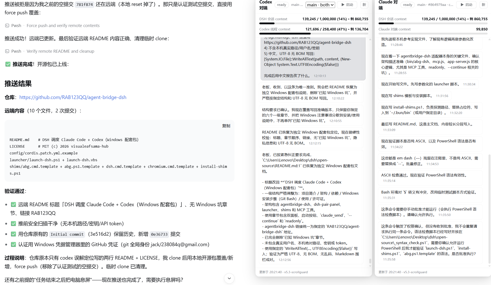

# DSH 调度 Claude Code + Codex

让 DSH（DeepSeek Harness）同时接入 **Codex pair** 与本机 **Claude Code** 的完整方案：MCP 适配器、对端面板、Windows 一键启动与配置。本仓库包含三个部分：



```text
agentbridge-dsh/   核心 MCP 适配器（Bun）：把 agent-bridge pair 协议转换为
                   DSH 可调用的 MCP 工具（send_message / get_messages /
                   pair_status / claude_send）
dsh-pair-panel/    DSH Web 插件：右侧显示 Codex / Claude 对端面板
launcher/          Windows 一键启动脚本（DSH Web + adapter + 浏览器窗口）
shims/             Windows 命令 shim 模板（abg / dsh / chromium）
config/            DSH MCP 配置示例
```

- **agentbridge-dsh**（[子目录](agentbridge-dsh/)）：用 Bun 运行的 MCP 适配器，连接
  [agent-bridge](https://github.com/raysonmeng/agent-bridge) daemon，让 DSH 既能加入
  Codex pair（channel/attach），也能对接 `abg claude`（server 模式）。详细用法见
  [agentbridge-dsh/README.md](agentbridge-dsh/README.md)。
- **dsh-pair-panel**（[子目录](dsh-pair-panel/)）：DSH Web 网页插件，读取 Codex
  rollout、适配器 feed 和 Claude Code 会话记录，显示单面板或 Codex / Claude 双面板。
  安装与配置见 [dsh-pair-panel/README.md](dsh-pair-panel/README.md)。
- **launcher / shims / config**：Windows 落地配套——自动探测依赖、生成命令 shim、
  配置 MCP、隐藏控制台窗口的一键启动。详见下文「Windows 安装步骤」。

> **来源**：`agentbridge-dsh/` 与 `dsh-pair-panel/` 分别由
> [visualeafsama-hub/agentbridge-dsh](https://github.com/visualeafsama-hub/agentbridge-dsh)
> 和 [visualeafsama-hub/dsh-pair-panel](https://github.com/visualeafsama-hub/dsh-pair-panel)
> 改进而来，完整 git 历史保留在各子目录中。


## 架构

```text
┌────────────────┐       MCP / HTTP       ┌───────────────────┐
│ DSH Web GUI    │ ─────────────────────▶ │ agentbridge-dsh   │
│ 会话与工具       │ ◀───────────────────── │ MCP adapter       │
└───────┬────────┘    127.0.0.1:8765      └─────────┬─────────┘
        │                                            │
        │ dsh-pair-panel                             │ attach / channel
        ▼                                            ▼
┌────────────────┐                         ┌───────────────────┐
│ Codex / Claude │                         │ agent-bridge      │
│ 双对端面板       │                         │ daemon + pair     │
└────────────────┘                         └─────────┬─────────┘
                                                   ▼
                                          ┌───────────────────┐
                                          │ Codex TUI / CLI   │
                                          └───────────────────┘

DSH ──MCP claude_send──▶ 本机 claude -p ──▶ Claude Code
```

各组件职责：

- **agentbridge-dsh 适配器**：使用 Bun 运行，连接 agent-bridge daemon，提供
  `send_message`、`get_messages`、`pair_status` 和 `claude_send` 等 MCP 工具。
- **dsh-pair-panel 面板**：读取 Codex rollout、适配器 feed 和 Claude Code
  会话记录，在 DSH Web 中显示单面板或 Codex / Claude 双面板。
- **launcher**：检查 DSH Web、pair control 端口和 MCP adapter 状态，按需启动
  缺失进程并打开 Chrome/Chromium 应用窗口。
- **shims**：在 Windows 上生成 `abg`、`dsh` 和 `chromium` 命令包装；
  `abg` shim 只拦截 `dsh` 子命令，其余参数继续透传给真实 agent-bridge CLI。
- **MCP 配置**：把本机 `http://127.0.0.1:8765/mcp` 注册到 DSH Web。

DSH 会话内可用的主要工具：

- `mcp__abg__send_message`：向当前 pair 对端发送消息并等待回复；
- `mcp__abg__get_messages`：获取尚未被消费的对端消息；
- `mcp__abg__pair_status`：检查 daemon、proxy、control 和 app-server 状态；
- `mcp__abg__claude_send`：调用本机 Claude Code CLI。

## 依赖

| 依赖 | 用途 | 安装说明 |
|---|---|---|
| [Bun](https://bun.sh/) | 运行 agentbridge-dsh | 按 Bun 官方方式安装 |
| Node.js 18+ | 运行 DSH CLI 等 Node 工具 | 建议使用当前 LTS |
| [agent-bridge](https://github.com/raysonmeng/agent-bridge) | pair、daemon 和真实 `abg` 命令 | 按其仓库说明安装 |
| [agentbridge-dsh](https://github.com/RAB123QQ/agent-bridge-dsh) | DSH 与 agent-bridge 之间的 MCP 适配器 | 单独克隆 |
| [Codex CLI](https://github.com/openai/codex) | pair 的 Codex 侧 | 按官方方式安装 |
| Claude Code CLI | `claude_send` 的本机执行入口 | 先完成登录或 API 配置 |
| `@deepseek-ai/dsh` | DSH Web 服务 | 全局安装或使用 npx |
| Chrome / Chromium | DSH 独立应用窗口 | 已安装 Chrome 即可 |
| PowerShell | 执行 launcher 和 shim 安装器 | Windows 5.1 可用，建议 7+ |
| Git Bash | 执行本文安装命令 | Git for Windows 自带 |

安装前在 Git Bash 中检查命令：

```bash
where.exe node
where.exe bun
where.exe abg
where.exe codex
where.exe claude
```

如果同一个命令返回多条路径，请确认 PATH 第一项是准备使用的版本。

## Windows 安装步骤（Git Bash）

以下命令在 **Git Bash** 中执行。PowerShell 也可以完成相同操作，但路径格式和
环境变量语法不同。

### 1. 安装前置工具

先安装 Bun、Node.js、agent-bridge、Codex CLI、Claude Code CLI、DSH 和
Chrome/Chromium，并确认上一节中的命令均能被找到。

### 2. 克隆本仓库

```bash
git clone https://github.com/RAB123QQ/agent-bridge-dsh.git ~/agent-bridge-dsh
cd ~/agent-bridge-dsh
```

### 3. 安装 agentbridge-dsh 适配器

```bash
cd agentbridge-dsh
./install.sh          # 安装 abg shim 到 ~/.bun/bin/abg
```

`install.sh` 生成 `abg` 薄包装：所有 `dsh` 子命令路由到本适配器，其余命令
（doctor / pairs / resume / kill / --pair ...）原样透传给真 abg。详细说明见
[agentbridge-dsh/README.md](agentbridge-dsh/README.md)。

### 4. 安装 dsh-pair-panel 面板插件（可选）

```bash
cd ~/agent-bridge-dsh
dsh plugin --profile web add "$PWD/dsh-pair-panel"
```

安装后重启 `abg dsh --pair <name>`（或刷新已打开的页面）。详见
[dsh-pair-panel/README.md](dsh-pair-panel/README.md)。

### 5. 安装 Windows shim

在仓库根目录执行（Git Bash 的 `$HOME/...` 是 POSIX 路径，PowerShell 需要
Windows 路径，因此使用 `cygpath -w` 转换）：

```bash
cd ~/agent-bridge-dsh
export AGENTBRIDGE_DSH_DIR="$(cygpath -w "$HOME/agent-bridge-dsh/agentbridge-dsh")"
powershell.exe -NoProfile -ExecutionPolicy Bypass \
  -File "$(cygpath -w "$PWD/shims/install-shims.ps1")"
```

安装器默认向 `%USERPROFILE%\.bun\bin` 写入：

- `abg.cmd` / `abg.ps1`；
- `dsh.cmd`；
- `chromium.cmd`。

脚本会自动探测 `node.exe`、Chrome/Chromium 和 DSH `bin.js`。如果探测失败，可在
PowerShell 中给 `install-shims.ps1` 显式传入 `-AdapterPath`、`-NodeExe`、
`-DshBinJs` 或 `-ChromeExe`。

确认 `%USERPROFILE%\.bun\bin` 位于 PATH 前部，然后重新打开 Git Bash：

```bash
abg doctor
abg dsh --help
```

`abg doctor` 应继续调用真实 agent-bridge；`abg dsh --help` 应显示
agentbridge-dsh 的帮助。

### 6. 配置 DSH MCP

把 `config/cordis.patch.yml.example` 中的插件配置合并到：

```text
$DSH_HOME/profiles/web/cordis.patch.yml
```

`DSH_HOME` 未设置时通常位于 `%USERPROFILE%\.dsh`。

配置必须使用 `- insert:`：

```yaml
- insert:
    - id: mcp-agentbridge
      name: '@deepseek-ai/dsh-mcp-client'
      config:
        serverName: abg
        transport: streamable-http
        url: http://127.0.0.1:8765/mcp
```

`cordis.patch.yml` 是 override 配置，直接新增 `- id:` 可能被静默忽略。保存后如果
DSH 工具列表没有更新，请重启 `dsh web`。

### 7. 配置桌面启动器（可选）

`launcher/launch-dsh.vbs` 与 `launcher/launch-dsh.ps1` 应放在同一目录。桌面
快捷方式指向 `launch-dsh.vbs`，它会隐藏 PowerShell 控制台窗口。

建议配置以下用户环境变量：

```text
AGENTBRIDGE_DSH_DIR=<agentbridge-dsh 克隆目录>
AGENTBRIDGE_DSH_PAIR=<pair 名称>
DSH_WORKDIR=<pair 对应的项目目录>
```

可选变量和脚本参数见 `launcher/launch-dsh.ps1` 文件头说明。

## 使用

### 双面板

先在目标项目目录启动 Codex pair：

```bash
cd /path/to/project
abg codex --pair main
```

然后在同一项目目录启动 DSH 侧：

```bash
cd /path/to/project
abg dsh --pair main
```

`abg dsh --pair main` 会启动 MCP adapter，并在默认模式下按需启动 DSH Web、
打开 Chrome/Chromium 应用窗口、attach 到指定 pair 并输出对话流。

配套 `dsh-pair-panel` 插件根据数据情况显示：

- 只有 Codex 数据：单个“Codex 对端”面板；
- 只有 Claude 数据：单个“Claude 对端”面板；
- 两侧都有数据：Codex / Claude 两个面板并排显示。

面板只负责显示消息、上下文和启动入口，不代替 agent-bridge 的通信链路。

pair registry 同时记录名称和 cwd。建议始终显式传入 `--pair NAME`，并确保 Codex、
DSH、launcher 的 `DSH_WORKDIR` 都指向同一个项目目录。

### 启动按钮

配置好 `launcher/launch-dsh.vbs` 后，可以通过桌面快捷方式一键：

1. 检查 DSH Web 是否已启动；
2. 检查 pair control 和 MCP adapter 是否可达；
3. 按需启动 `abg dsh --pair <NAME>`；
4. 打开 Chrome/Chromium 应用窗口。

脚本不会重复启动已监听的服务。日志写在 launcher 目录：

- `launch-dsh.log`；
- `dsh-web.log`；
- `abg-dsh.log`。

面板中的 Codex / Claude 启动按钮会请求宿主启动对应侧。宿主应负责启动状态、重复
点击保护和错误反馈；“存在历史消息”不等于对应进程当前仍在运行。

### `claude_send` 工具

`mcp__abg__claude_send` 会在 pair 工作目录中运行：

```text
claude -p <提示词>
```

它使用本机 Claude Code 的登录/API 配置，不通过本配套包保存任何密钥。

常用参数：

- `text`：发送给 Claude Code 的提示词；
- `timeoutMs`：最大等待时间；
- `continue`：是否延续当前 cwd 的最近会话，默认 `true`；
- `readonly`：是否增加 `--permission-mode plan`，默认 `false`。

Windows 下可通过 `ABG_CLAUDE_BIN` 指定 Claude Code 的可执行入口。如果 PATH 中
的 `claude` 实际解析为无法被 Node 直接启动的 `.cmd`，应把该变量指向可执行程序
或显式调用 `cmd.exe` 的包装入口。

### `--continue` 上下文延续

`claude -p` 每次调用都会启动新的 Claude Code 进程。`continue: true` 只表示增加
`--continue`；Claude Code 会根据当前 cwd 选择最近一次会话，不是 MCP adapter
在内存中维护上下文。

这意味着：

- 同一 cwd 下连续调用，才能延续该目录最近的 Claude Code 会话；
- 更换 pair 工作目录后，不会继续原项目的最近会话；
- 多个 DSH 会话并发复用同一 cwd，可能争用同一条最近会话；
- 与上一任务无关时，使用 `continue: false` 开启独立会话。

### `readonly` 只读模式

`readonly: true` 会给 Claude Code 增加：

```text
--permission-mode plan
```

适合代码阅读、方案设计和不希望落地修改的任务。需要注意：

- 只读边界由 Claude Code 自身的 plan 模式实现；
- 它不是本配套包额外提供的操作系统沙箱；
- 高风险或不可信项目仍应使用独立目录、虚拟机或容器；
- 默认 `readonly: false` 时，Claude Code 可能读取和修改文件、运行命令。

## 许可证

MIT，见 [LICENSE](LICENSE)。